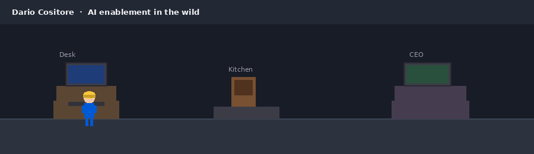

  

  

  
  
  
  
  

---

## About

Solo AI consultant and builder, based in Italy, working remotely worldwide. Nine years across automation, training, and operations; the last two building on frontier models. I evaluate models, design agentic workflows, set governance, and train teams to run the system without me.

Three principles guide everything I ship:

- **Fix the process first.** Automating a broken process just breaks things faster.
- **You stay in control.** Approval gates, audit logs, override any decision.
- **You keep it when I leave.** Documentation, training, and monitoring ship with every build.

## Now

- 🔭 Building **[Elitza](https://github.com/dario-cositore/elitza-code)**, a bring-your-own-key AI agent for the terminal, browser, and desktop (memory, personas, skills, MCP).
- 🛡️ Building **[AKLI](https://github.com/dario-cositore/api-key-leak-intercept)** (API Key Leak Intercept), a Chrome extension that warns you before you paste an API key, secret, or PII into any AI chat. Detection runs locally; free tier is open source.
- 🧪 Benchmarking frontier models on real business workflows for a domain-expert panel (13+ models so far).
- 📝 Writing technical breakdowns at [dariocositore.com](https://dariocositore.com).

## Stack

  

  
  
  

## Featured projects

| Project | What it does | Stack |
|---|---|---|
| [**Elitza**](https://github.com/dario-cositore/elitza-code) | Bring-your-own-key AI agent for terminal, browser, and desktop. Memory, personas, skills, MCP. One-line install. | TypeScript |
| [**website-to-skill**](https://github.com/dario-cositore/website-to-skill) | Turn any website into a Hermes Agent Skill or OpenClaw Agent Package. | Python |
| [**durable-workflows**](https://github.com/dario-cositore/durable-workflows) | Mistral-style durable execution for OpenClaw. Tasks survive crashes and restarts. | JavaScript |
| [**url-to-markdown-rust**](https://github.com/dario-cositore/url-to-markdown-rust) | Website to Markdown converter. | Rust |
| [**api-key-leak-intercept**](https://github.com/dario-cositore/api-key-leak-intercept) | Chrome extension that warns before you paste an API key, secret, or PII into any AI chat. Detection runs locally. | JavaScript |
| [**elitza-workshop**](https://github.com/dario-cositore/elitza-workshop) | Unified agent installer and hub for OpenClaw and Hermes Agent. | JavaScript |
| [**OpenConnect**](https://github.com/dario-cositore/OpenConnect) | Turn any webpage into an MCP connector. *(on hold)* | Python |

## Play

[**Office Hustle**](https://dario-cositore.github.io/dario-cositore/office-game/) — a tiny HTML5 game. Run the office, type, caffeinate, yell "AI ENABLEMEEEEENT!", ship. Arrow keys + E.

## Quote of the day

<!--QUOTE-START-->
> "Premature optimization is the root of all evil." — Donald Knuth
<!--QUOTE-END-->

## GitHub stats

  
  

  

## Connect

Open to collaborations, consulting, and interesting problems around AI agents, MCP, developer tooling, and autonomous systems.

- 🌐 [dariocositore.com](https://dariocositore.com)
- 💼 [LinkedIn](https://www.linkedin.com/in/dario-cositore)
- 🐦 [X / Twitter](https://twitter.com/DarioCositore)
- ✉️ [dario@dariocositore.com](mailto:dario@dariocositore.com)

---

  Built from Italy.

  <picture>
    <source media="(prefers-color-scheme: dark)" srcset="https://raw.githubusercontent.com/dario-cositore/dario-cositore/output/github-contribution-grid-snake-dark.svg" />
    <source media="(prefers-color-scheme: light)" srcset="https://raw.githubusercontent.com/dario-cositore/dario-cositore/output/github-contribution-grid-snake.svg" />
    
  </picture>

  

